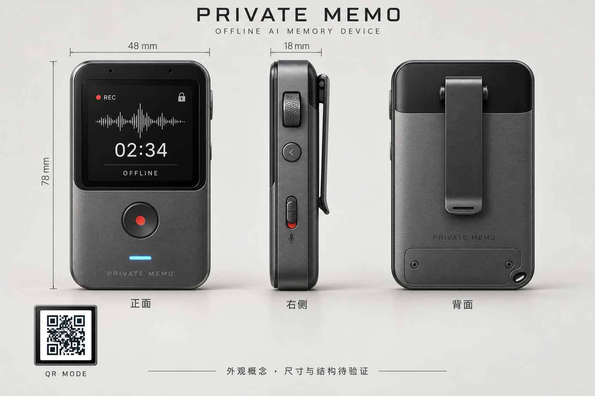

# Private Memo 架构设计

> 调研和性能证据见[调研报告](../research/调研报告.md)，所有启动、部署、复测命令见[项目 README](../../README.md)。

## 1. 目标、约束与实现状态

目标是便携记录、默认本地转写和加密、通过用户钱包提交密文，并在设备丢失后用原钱包恢复转写文本。设备包含摄像头与 Wi-Fi；用户可显式切换到第三方语音 Provider。优先级为隐私、防丢失、便利性。设备不持有钱包交易私钥，不要求用户向新流程输入钱包助记词，不引入专用明文业务后台。

| 能力 | 当前状态 |
| :--- | :--- |
| 本地录音、ASR、转写文本 AES-GCM 加密 | 原型已实现；R2T2 / Paraformer / SenseVoice 可切换 |
| 钱包签名配对、calldata 提交、同钱包恢复 | 有代码与自动化验证记录；imToken 签名可重现性仍待完整真机验收 |
| Base Sepolia 合约、HTTPS 静态页面 | 已有部署记录；未部署生产主网 |
| 原始 WAV | 保存在本地；尚未链上备份 |
| 配对秘密存储 | 模拟器明文 `lab/.pairing`；SE/TEE 尚未集成 |
| 配对回传 | Android 原型已实现摄像头实时扫描签名数据二维码；短时有效、设备绑定与防重放仍待量产实现 |
| Wi-Fi / 语音 Provider | Android 原型支持局域网 Whisper 与 OpenAI Audio Transcriptions 兼容接口；默认关闭 |
| BLE、动态二维码、AA/Paymaster、Passkey | 未集成产品路径；AA 合约测试不等于产品代付 |
| 每日摘要 | 独立 Qwen3-0.6B Q4；按日聚合多条转写，支持手动与新增转写后自动更新 |
| 历史检索 / RAG | 规划项：先使用本地全文索引/BM25；语义召回不足时再评估 bge-small-zh-v1.5 |
| 伴聊、TTS | 不属于当前设备 UI，后续独立评估 |
| RK3576 性能、功耗、电池续航 | 未完成真板验证；Mac/OrbStack 不可替代 |

隐私边界是提交前在设备加密，恢复后在用户授权的浏览器本地解密。原始录音、转写缓存、模拟器配对文件的本地保护仍需量产设计；不能宣称设备磁盘已经全面加密。链上 owner、时间和活动元数据公开，内容加密不等于匿名。

## 2. 系统分工与数据路径

```text
设备 / 模拟器
  麦克风 → 本地原始 WAV → 可选降噪 → 本地 ASR / 局域网 Whisper / HTTPS Provider → 转写文本
                                                ↓
                              KEK → 派生 CK → AES-256-GCM
                                                ↓
                            密文 + SHA-256 + owner → 二维码
                                                ↓
手机钱包内 HTTPS DApp → 校验配对 owner → 钱包确认交易
                                                ↓
MemoryRegistry / Base Sepolia → calldata 密文 + MemoOnchain 事件
                                                ↓
恢复页 → 按 owner 枚举 → 获取交易 input → 按偏移切片 → 校验摘要
                                                ↓
                   同钱包恢复声明签名 → 重建 KEK → 浏览器本地解密
```

| 部件 | 源码与职责 |
| :--- | :--- |
| 设备服务 / UI | [`lab/server.py`](../../lab/server.py)、[`lab/ui/index.html`](../../lab/ui/index.html)：录音、模型切换、配对与出码 |
| 录音识别 / 结构化实验 | [`lab/mic_rt.py`](../../lab/mic_rt.py)、[`lab/structure.py`](../../lab/structure.py)；结构化脚本不等于 UI 已集成 |
| 设备加密 | [`lab/crypto/pipeline.py`](../../lab/crypto/pipeline.py) |
| 载荷编码 | [`web3/tools/make_payload.py`](../../web3/tools/make_payload.py) |
| 钱包协议 | [`web3/app/wallet_pairing.js`](../../web3/app/wallet_pairing.js) |
| 浏览器解密 / 页面 | [`web3/app/crypto.js`](../../web3/app/crypto.js)、[`web3/app/index.html`](../../web3/app/index.html) |
| 合约 | [`web3/src/MemoryRegistry.sol`](../../web3/src/MemoryRegistry.sol) |

## 3. 本地音频与模型生命周期

记录保留原始 WAV，不以降噪结果覆盖；降噪用于试听与转写，保留切换比较的能力。VAD 按短块接收采样，输出语音区间后再识别，避免固定时间片切碎句子。历史参数为块长 0.1s、trailing 1.0s、threshold 0.5、min-speech 0.4s、max-utt 15s；具体值以所用脚本与模型配置为准。

实现约束：VAD 内部样本缓冲在 `pop()` 前复制；无语音区间不直接送 ASR；重复字过滤只能作为兜底，不能替代静音和噪声评测。VirtIO 环境原生 48kHz 声卡可经 `arecord -D plughw:0,0` 重采样，真板设备名需按 ALSA 实测。

`mic_rt.py` 的独立实验用 JSONL 追加写入 `session` / `seg`，保留段起点 `t`、时长 `dur` 和文本；后处理可追加 `memo`，包括 title、summary、tags、todos。JSON 合法性、数量上限和类型由代码检查，模型可能虚构待办，须独立验证语义。

`structure.py` 使用按需模型服务：仅关闭自己启动的实例，已存在的服务不代为停止，`--keep-server` 可保留实例。Qwen 非思考实验显式关闭 thinking，接口自动化使用服务 API。它们是历史结构化设计，不是当前首版伴聊依赖。

默认模型仍须由同一测试集与 RK3576 真板决定。当前 UI 默认 R2T2 不代表量产确定；准确率、峰值内存、实时率、功耗、温度和商用许可都要达标。

## 4. 用户流程与钱包密钥协议

### 4.1 产品原则

1. 钱包助记词只存在于钱包自身的安全边界内。
2. 上链交易签名只证明写入授权，不能作为秘密使用；交易签名公开在链上。
3. 恢复签名是另一份固定 EIP-712 声明，不广播、不上链。
4. 设备只保存 32 字节 KEK、配对 owner 和方案版本；不保存钱包私钥或助记词。
5. 新记录只能由配对 owner 提交，页面在发交易前校验当前账户。
6. 钱包若不能对同一声明产生可重现签名，配对必须失败，不能产生无法恢复的数据。

### 4.2 用户流程

#### 4.2.1 首次配对

1. 设备显示“钱包签名配对”二维码。
2. imToken 扫码打开 HTTPS DApp，用户连接钱包。
3. 页面要求对同一 EIP-712 恢复声明签名两次。
4. 页面归一化两份签名并比较；不一致立即终止。
5. 页面从签名材料派生 KEK，显示 KEK 指纹与一次性配对凭据。
6. 手机页面把一次性配对凭据显示为二维码，设备用摄像头扫描；模拟器保留粘贴回退。
7. 设备把 KEK 与 owner 写入安全元件，配对完成。

两次签名只用于首次能力探测。某一 imToken 版本和账户类型通过兼容性验收后，正式产品可把首次配对简化为一次签名，但每个受支持账户类型仍需回归测试。

#### 4.2.2 日常记录与上链

1. 设备录音并本地转写。
2. 设备用 KEK 派生记录密钥，以 AES-256-GCM 加密转写文本。
3. 二维码携带密文、摘要、配对 owner、链和合约。
4. 页面只允许配对 owner 发起 `addBatchOnchain`。
5. 钱包确认交易；密文进入 calldata，`MemoOnchain.owner = msg.sender`。

当前 P0 上链的是转写文本，不是原始 WAV。原始音频上链需要多帧二维码或 BLE 数据通道。

#### 4.2.3 换机恢复

1. 用户打开带有链、合约、owner 和密钥方案的恢复页。
2. 连接原配对钱包。
3. 钱包签署一次与配对时相同的 EIP-712 恢复声明。
4. 页面本地重建 KEK，按 owner 枚举 `MemoOnchain`。
5. 页面取回交易 calldata，先核对 SHA-256，再以 AES-GCM 解密。

恢复入口长期可从设备“钱包与二维码 → 恢复链上记录”重新生成。二维码只包含公开的链、
合约、owner 和密钥方案，不含 KEK、签名或录音内容；设备丢失时也可由可信页面根据
这些公开字段重建同一个恢复链接。

同一条转写文本每次生成存证二维码时都会创建新的时间戳和随机 96 位 AES-GCM nonce，
所以密文、内容摘要与二维码都会变化。若用户分别广播多次，每次都是独立的链上记录；
只生成二维码而没有在钱包确认交易时，不会产生链上记录。

恢复过程不消耗 gas，也不要求钱包助记词。钱包丢失后的恢复能力由钱包自身的备份、智能账户、Passkey 或社交恢复负责，Private Memo 不再另建一套助记词体系。

### 4.3 签名与密钥协议

#### 4.3.1 EIP-712 声明

```text
domain:
  name: Private Memo
  version: 1
  chainId: 当前链 ID
  verifyingContract: MemoryRegistry 地址

RecoveryKey:
  owner: 配对钱包地址
  purpose: "Derive Private Memo recovery key"
  version: 1
```

调用方法为 `eth_signTypedData_v4`。签名不得写入 URL、日志、链上交易或分析系统。

#### 4.3.2 归一化与派生

```text
material = r || low_s
salt     = uint256(chainId) || contract(20B) || owner(20B)
KEK      = HKDF-SHA256(material, salt, "vmemo/wallet-kek/v1", 32B)
CK_i     = HKDF-SHA256(KEK, uint64be(timestamp), "vmemo/ck/v1", 32B)
blob     = 0x03 || nonce(12B) || AES-256-GCM(CK_i, plaintext, AAD)
AAD      = "vmemo/v1" || uint64be(timestamp)
```

ECDSA 的 `(r,s)` 与 `(r,n-s)` 等价，因此先归一化到 low-s，并丢弃恢复标识 `v`。链、合约和 owner 进入 salt，防止同一份签名材料跨产品上下文复用。

### 4.4 安全边界

- 恢复签名在本协议中属于秘密派生材料。它虽然是“签名”，但不能像普通公开签名一样发布。
- 恶意或被攻陷的恢复页面可以读取派生后的明文；生产页面必须固定可信域名、启用 CSP/SRI、版本签名和可复现构建。
- 当前签名数据二维码的凭据直接包含 KEK，只用于原型验证；它必须短暂展示、不得截图或经云端传输。量产格式必须加入短时有效、一次性 nonce、设备身份绑定和防重放，并在安全元件内落地。
- 交易签名公开，绝不能代替恢复签名。
- 钱包账户更换后，旧记录仍绑定旧 owner 和旧恢复签名。密钥轮换需要单独的“旧钱包授权迁移到新钱包”协议。
- EIP-712 签名可重现性不是标准保证。每个 imToken 版本、EOA/智能账户类型都必须实测。
- `0x03` 的 KEK 来源依赖 secp256k1/ECDSA 钱包签名，不能宣称端到端抗量子。

### 4.5 兼容与迁移

| 方案字节 | 密钥来源 | 状态 |
|---|---|---|
| `0x02` | BIP-39 设备恢复词 | 只读兼容，页面保留旧记录恢复入口 |
| `0x03` | 钱包 EIP-712 恢复签名 | 新记录默认方案 |

旧版 `addBatch` 只写摘要和 CID 占位符，没有密文，无法迁移或恢复。旧版 `0x02` 的 `addBatchOnchain` 记录仍可用原设备恢复词解密。

已经显示 `mnemonic-v1` 的设备不能仅靠升级软件自动变为钱包签名方案，因为两种方案
产生的 KEK 不同。迁移步骤如下：

1. 先用旧恢复词确认既有 `0x02` 记录仍可读取。
2. 设备设置明确显示“旧版助记词配对 · 待迁移”；打开“迁移到钱包签名配对”，
   使用 imToken 内的“扫一扫”扫描默认的钱包 Universal Link 二维码，并用目标 owner 连续签署两次声明。
3. 通过模拟凭据或真机 BLE 写入新的 `wallet-signature-v1` KEK。
4. 设备状态显示新方案与 owner 后，后续记录改用 `0x03`。
5. 旧记录仍走旧版恢复入口；新记录走“恢复记录二维码”，两者不可混用 KEK。

生产迁移应在写入新 KEK 前导出或验证旧记录，且提供明确的不可逆确认；当前模拟器
直接覆盖 `.pairing`，只用于协议验证。

已配对设备必须提供两个独立操作：

- **更换配对钱包**：生成新钱包配对码；导入时二次确认并校验当前 KEK 指纹，只有新凭据
  通过校验并写入设备后才覆盖旧 KEK。旧记录不会自动迁移。
- **清除配对**：二次确认后删除设备保存的 KEK 和 owner，回到未配对状态。录音及链上
  记录继续保留，但设备不再能解密依赖该 KEK 的旧记录；用户必须仍持有原钱包或旧恢复方式。

默认钱包二维码使用 Universal Link，由 imToken 内置“扫一扫”或手机系统相机打开；
第二个二维码保留直接 DApp URL，用于诊断静态页面是否存在。Universal Link 包含一层
嵌套 URL，钱包导航可能在 fragment 后追加参数，因此页面解析 `#k=`、`#p=`、`#r=`
时必须先切除导航参数再解码载荷。

### 4.6 当前实现与验证

- 浏览器协议：`web3/app/wallet_pairing.js`
- 设备密文格式：`lab/crypto/pipeline.py`
- 模拟器配对与 owner 约束：`lab/server.py`
- 协议测试：`node web3/tools/wallet_pairing_e2e.mjs`

自动化验证覆盖：high-s/low-s 归一化、上下文绑定、稳定/不稳定签名、错误 owner、一次性凭据结构、Python 设备端与浏览器端交叉解密。

浏览器恢复验证还覆盖：钱包方案不显示助记词输入；恢复只请求一次
`eth_signTypedData_v4`；链上摘要校验通过后显示明文；错误账户在请求恢复签名前被拒绝。

尚未由自动化替代的真机验收：

1. imToken 对相同 EIP-712 声明连续签名两次，归一化结果一致。
2. 关闭并重开 imToken 后再次签名，结果仍一致。
3. 切换网络再切回目标链后结果一致。
4. EOA、智能账户分别验证；不把一种账户的结论外推到另一种。
5. 升级 imToken 后执行恢复回归，成功后才允许继续写入新记录。


## 5. 传输、屏幕与钱包边界

产品采用设备显示二维码、手机打开可信 HTTPS DApp 的路径。设备自身无需 RPC 或 WalletConnect 会话。imToken 的集成基于钱包 provider、链接唤起与网页签名；不假定存在第三方可用的 imKey 蓝牙协议或通用 ECDH 解密接口。WalletConnect 因连接稳定性、SDK 集成复杂度、持续升级和第三方 Relay 依赖不进入产品路线。

日常短文本传输与首次配对的秘密回传是不同问题。硬件已纳入摄像头，Android 原型使用应用内实时取景扫描手机显示的签名数据二维码，并保留复制粘贴作为实验回退。静态二维码本身不提供接收方认证或防重放，因此量产协议必须把设备身份、会话 nonce、过期时间和双方确认绑定进二维码载荷；不能仅凭“可扫码”宣称安全配对已经完成。

| 方案 | 结论 |
| :--- | :--- |
| 小屏单帧二维码 | 当前主路径；保留显示能力，一次显示单条或可容纳的小载荷 |
| NFC 无屏 | 原方案已撤回，当前钱包路径不能以 NFC 替代显示 |
| 独立 App + BLE | 不进入首版短文本提交；安全配对回传需另行解决 |
| BC-UR 动态二维码 / BLE 大数据 | 原始音频传输候选，尚未实现 |

二维码包含 Universal Link / DApp URL 和编码载荷，密文载荷放在 fragment；fragment 不随常规 HTTP 请求发送，但页面脚本仍能读取，不能当作秘密隔离边界。嵌套链接编码、钱包追加 fragment 参数和 `hashchange` 都需正确处理。

旧文档同时写“至少 244px”和“240×240 足够”，存在矛盾；不能直接据此定型屏幕。外观概念建议从约 1.54 英寸、320×320 或更高分辨率验证；按真实链接长度、quiet zone、像素密度、亮度与扫码距离实测后确定。二维码版本和载荷长度变化时必须重新评估。

二维码渲染应有完整 `viewBox`、明确白色背景和至少四模块静区，避免裁切及低密度缩放；应对按实际屏幕像素光栅化的结果执行解码，再用真实手机扫码。QR MODE 外观插图仅是示意，不是可用载荷。单帧理论容量不是本机可读容量，不承诺原始 WAV 能用单码传输。

## 6. 合约、恢复、归属与同步

当前使用共享 `MemoryRegistry`，以钱包 owner 分隔记录；`addBatchOnchain` 将密文放入交易 calldata，`MemoOnchain` 保存恢复所需事件信息和切片位置。旧 `addBatch` 的 CID 占位记录没有密文，不能自动转换为可恢复的新记录。

所有用户可以与同一个 `MemoryRegistry` 合约交互。合约以实际交易发送者 `msg.sender` 作为
owner，并分别维护 `count[owner]`；事件的第一个 indexed topic 也是 owner。用户 A 不能把记录
写进用户 B 的地址空间，也不能覆盖 B 的记录。恢复页同时按合约地址和原钱包 owner 过滤事件，
再使用该钱包独立派生的 KEK 解密，因此共享合约不等于共享明文或共享密钥。链上仍会公开钱包
地址、交易时间和活动频率等元数据。

恢复从目标链、合约、部署区块开始，按 owner 过滤事件，获取交易 input，按 `blobOffset` / `byteLength` 切出密文并核对 SHA-256，再执行 GCM 认证解密。多笔交易必须分别定位切片，不能拿全局 seq 索引一笔交易的 blob 数组。

当前实验 APK 可把 `.env` 中的只读 RPC 带入页面；这不是正式产品架构。正式产品的签名、广播和恢复读取全部使用 imToken 注入的 provider。Base Sepolia 索引版合约已按 owner 保存每次批次所在的 `block.number` 并提供分页读取，恢复端先用 `eth_call` 取得相关区块，再对这些区块逐个查询事件，不再从合约部署块到最新区块进行全链扫描。旧合约兼容路径仍保留自适应分块，但超过 100 次预计请求会直接停止。RPC 返回、页面代码和链配置仍属于可信边界的一部分；普通 RPC 读取与摘要比对不等于已实现链上轻客户端证明。

记录发起方必须是配对 owner。普通热钱包代发会把 `msg.sender` 变成中继地址，破坏归属。未来 AA 代付应保持用户智能账户为 owner，并重新验证签名恢复协议，不能将本地 AA 合约实验视为量产接入。

本地发件箱的建议状态为 `local → pending → confirmed / failed`，以交易收据和链上事件核对最终状态。当前本地“已生成二维码/已登记”不应直接解释为链已确认；端到端设备自动回执与对账仍需验收。

## 7. 兼容、威胁边界与未完成项

`0x03` 是新记录钱包签名方案，`0x02` 只读兼容助记词方案，早期 `0x01` 混合方案不进入新路径。旧版恢复仍需原秘密；不让新流程引导用户输入钱包根秘密。版本升级必须保持历史记录可读。

更早的 ECIES/X25519 钱包解封装、逐条 wrappedKey、NFC 无屏方案已被替代，不作为当前备选实现。旧技术文档关于“签名已整体移除”的段落只对应旧 `0x02` 阶段，不能覆盖新产品方案的 `0x03`。

| 边界 / 风险 | 处理原则 |
| :--- | :--- |
| 固定 EIP-712 签名不保证可重现 | 配对签两次，钱包重启、网络切换、升级后回归；账户类型分别验收 |
| 恢复签名和 KEK 泄露 | 它们是解密秘密，不放 URL、日志、分析系统；交易签名公开，不能混用 |
| 真机配对和物理提取 | 认证回传、SE/TEE、固件签名与可验证构建待实现，不以模拟器文件代替 |
| 静态页面被替换或不可用 | 自有域名、注册商锁与 MFA、最小发布权限、CSP、可复现构建、双托管和 DNS 切换演练为生产要求 |
| 本地录音和缓存 | 明确原始音频及明文缓存生命周期；本地磁盘加密不是当前已交付能力 |
| 密文长期可获得 | 测试网无永久保证；验证日志与历史交易可读性，评估额外备份与导出 |
| 钱包丢失、迁移和智能账户 | 依赖钱包自身恢复；换钱包不会自动迁移 KEK 与旧记录，须另设迁移协议 |
| 量子安全 | `0x03` 依赖 secp256k1/ECDSA，不宣称端到端抗量子 |

主网、AA 代付、原始音频编码与备份、动态二维码、安全元件、安全配对通道、RK3576 电源与热设计均是后续工作。设备上链短文本成功不能替代这些验收。

## 8. 验证矩阵与发布门槛

下表来自原文历史验证记录，条数和结果不代表本次归档重新运行；各脚本当前输出才是复测依据。

| 验证 | 原历史记录 | 文件 |
| :--- | :--- | :--- |
| 设备加密 | 24 项通过 | `lab/crypto/pipeline.py` |
| 合约逻辑 / gas / AA | 8 / 3 / 5 项通过 | `web3/test/` |
| Python / JS 交叉加解密 | 21 项通过 | `web3/tools/crypto_crosslang.mjs` |
| ABI 编码 | 7 项逐字节比对一致 | `web3/tools/verify_abi.mjs` |
| 旧方案换机恢复 | 21 项通过 | `web3/tools/recovery_e2e.mjs` |
| 密文载荷 | 7 项通过 | `web3/tools/blob_payload_e2e.mjs` |
| EVM 端到端 | 23 项通过 | `web3/tools/e2e.mjs` |
| 新钱包配对协议 | 归一化、上下文绑定、错误 owner、稳定/不稳定签名与跨语言解密 | `web3/tools/wallet_pairing_e2e.mjs` |

历史已发现并修正的问题包括嵌套 ABI 动态数组偏移、多笔交易恢复切片、SVG 裁切/透明背景、provider 注入时序，以及 RPC 分块范围解析。后续回归应覆盖这些真实失效场景。

发布必须补齐：imToken 真机完整提交与恢复、目标账户签名可重现性、真实小屏扫码、设备配对认证和秘密存储、断电/升级后兼容，以及 RK3576 的质量与功耗温度测试。恢复无 gas 需求不等于无 RPC 或页面可用性依赖。

## 9. 无开发板阶段的选型结论与硬件复现清单

> 核对日期：2026-10-15。现阶段没有目标开发板，以下是验证方案与缺件清单，不是采购完成记录或板级性能承诺。

### 9.1 模型能运行到哪一层

应分别验证：能安装 / 编译运行时、能加载完整模型、能正确转写、速度可接受、整机功耗与热设计可接受。前几项成功不能代替后几项。

| 模型 | 当前证据 | RK3576 上尚缺的证据 |
| :--- | :--- | :--- |
| Paraformer | ARM64 虚拟机已运行；Seeker Android 真机完成固定音频、真实麦克风、VAD 与 3 轮 CPU 基准 | RK3576 板上依赖、独立标注集质量、长录音、功耗与持续温度 |
| SenseVoice | Seeker Android 真机完成完整 int8 模型加载、固定音频与多场景样本 CPU 推理 | 同上；不能用厂商样本断定总体质量 |
| R2T2 | 固定 llama.cpp 已在 ARM64 Linux 与 Android CPU 运行完整 Q4 主模型 + Q8 mmproj；Seeker 3 轮 RTF 中位数 0.676 | RK3576 重编译与指令兼容、持续温度、单位录音能耗；RKNN 加速尚未证明 |

R2T2 的 OrbStack 样例为 6.74s 音频，连续推理约 1.648 / 0.938 / 0.907s，最大 RSS 约 3.06GB（十进制）；底层是 Mac CPU、虚拟机 15GiB 内存。它支持“具备 ARM64 软件可运行性”的判断，不支持“RK3576 8GB 已达标”的判断。8GB 是合理的候选验证容量，不是已证明充足的整机预算。

2026-10-15 使用断网的 Solana Mobile Seeker（MT6878、Android 15、约 8GB RAM）做了第二层真机验证。相同 6.74s 音频、4 CPU 线程、每模型 3 轮的结果如下；原始记录在 `lab/android/results/device/`。

| 模型 | 冷加载 | 推理中位数 | RTF 中位数 | 最大 PSS | 失败 |
| :--- | ---: | ---: | ---: | ---: | ---: |
| Paraformer int8 | 2.17s | 94ms | 0.014 | 245,402KiB | 0/3 |
| SenseVoice int8 | 2.14s | 248ms | 0.037 | 440,776KiB | 0/3 |
| R2T2 Q4 + mmproj Q8 | 2.34s | 4.55s | 0.676 | 3,054,853KiB | 0/3 |

应用清单不申请 `INTERNET`，每条结果均记录飞行模式开启且无活动网络。另完成 12 次普通话、中英混说、四川方言和 8kHz 厂商样本推理、真机麦克风录音、静音与双语音段 VAD、Android/Python 加密互操作和二维码编解码。这说明 8GB arm64 移动设备可承载当前完整软件链；它仍不是 RK3576 指令、内存带宽、驱动、功耗或散热的替代数据，厂商样本也不能用于决定最终识别模型。

R2T2 官方提供 llama.cpp 路径，但预编译包针对 Linux x86_64/CUDA；其他平台需要重建。当前程序没有接入 RKNN 后端。RK3576 支持 NPU 不代表现有 GGUF / ONNX 可直接使用它；GPU、CUDA 与 Rockchip NPU 不是同一种运行后端。[R2T2 官方说明](https://github.com/netease-youdao/Confucius4-R2T2/blob/master/r2t2_llama/README.md)、[Rockchip 模型适配列表](https://github.com/airockchip/rknn_model_zoo)。

### 9.2 第一套桌面验证硬件

目标是先证明模型和录音链路可用，暂不承诺便携尺寸或续航。建议只用一块 RK3576 8GB 开发板建立 CPU 基线；若 CPU 已满足质量、延迟和能耗目标，不必为了使用 NPU 而先做转换。

可核对的候选为 Radxa ROCK 4D 8GB。官方列出 RK3576、8GB LPDDR5 选项、USB、存储扩展、HDMI / MIPI DSI、SPI / I2C / I2S / GPIO，以及板载蓝牙。选购时确认实际板卡版本、官方系统镜像、模块兼容性和供电要求，不根据芯片型号猜测板上接口。[官方规格](https://docs.radxa.com/en/rock4/rock4d)。

| 部件 | 用途与选型边界 |
| :--- | :--- |
| RK3576 8GB 开发板 | 目标 CPU / 内存基线；不同时购买多块高性能板来替代目标平台测试 |
| 与板卡匹配的电源与线材 | 按官方板卡供电规范；先排除供电不足导致的重启和降频 |
| microSD 或兼容 eMMC 与读写工具 | 系统、运行时、模型、录音与结果；建议从 32GB 或更大容量评估，依保留录音量扩容 |
| 散热器，必要时风扇 | 先测不受散热限制的软件基线，后续再测便携被动散热工况 |
| Linux ALSA 可识别的 USB 麦克风 / 音频设备 | 先验证录音到转写；最终数字 MEMS 阵列另行适配 |
| 电压 / 电流 / 功率记录设备 | 测启动、待机、录音和推理能耗；仅 USB 输入侧读数不能代替最终电池侧测量 |

现有电脑可 SSH 连接，第一轮固定 WAV 基准无需麦克风或本机屏幕。HDMI 显示器可复用做 UI 调试；后续的小屏可扫性必须在目标小屏验证。串口调试器可作为系统启动失败时的辅助工具。

### 9.3 完整便携样机还缺什么

| 模块 | 所需硬件 | 还缺的软件 / 工程集成 |
| :--- | :--- | :--- |
| 拾音 | 2–4 MEMS 麦克风、与之匹配的采集前端；是否需独立 Codec 按 PDM / I2S / 模拟接口确定 | 内核 / 设备树、ALSA、通道与采样率、噪声和安装声学测试 |
| 本机显示 | 可驱动的小型方屏；从 320×320 或更高分辨率验证 | SPI / DSI / 显示驱动、界面渲染、真实像素 QR 与手机扫码测试 |
| 摄像头 | 支持近距离二维码对焦的摄像头模组，优先确认固定焦或自动对焦的工作距离 | MIPI CSI / USB 驱动、实时预览、长配对载荷解码、低亮度与反光测试 |
| Wi-Fi | 与主控兼容的 Wi-Fi 模组及天线 | 联网配置、状态与断网恢复、TLS 证书校验、Provider 超时和隐私模式 |
| 物理交互 | 录音键、按压滚轮、返回键、状态 LED | GPIO / 输入事件、消抖、长短按、导航与反馈；现有浏览器交互不等于硬件驱动 |
| 麦克风隐私开关 | 拨钮及真实硬件关断设计 | 明确关断的是采集电源 / 信号路径，并验证硬件行为和状态显示一致 |
| 首次安全配对 | 摄像头扫描手机侧签名数据二维码 | 已有实时扫描原型；量产仍需设备身份、过期时间、nonce、防重放与用户确认 |
| 联网能力 | Wi-Fi 模组与天线净空 | 网络状态、断网恢复、证书校验、Provider 超时和隐私提示 |
| 秘密保护 | 与协议兼容的 SE / TEE 及接口电路 | 验证 KEK 导入、存储、HKDF / AES-256-GCM 的执行边界与宿主暴露范围；不能仅购买安全芯片就视为解决 |
| 便携供电 | 电池、充电 / 电源路径、保护、稳压、电量计 | 休眠 / 唤醒、关机保存、低电量处理；是否需要外置低功耗 MCU 取决于实测和板上控制能力 |
| 本机回放（若保留） | 扬声器与功放，或耳机输出 | 音频路由与播放控制；当前主线不因此增加 TTS / 伴聊 |
| 结构与热设计 | 核心板或定制 PCB、连接件、外壳、背夹、热扩散结构 | 天线与金属壳避让、拾音孔、电池隔热、皮肤接触温度与可靠性 |

摄像头关闭了“手机无法向设备回传配对秘密”的交互缺口，但没有自动解决安全协议。必须继续验证真实屏幕亮度、对焦距离、长载荷扫码率、二维码过期、防重放、设备身份绑定与旁观者拍摄风险。

78 × 48 × 18mm 外观包络、约 1.54 英寸屏幕和 24–48h 早期续航目标均未通过堆叠与功耗验证。开发板桌面闭环成功后，仍需独立验证便携化；不直接按现有外观图开模。

### 9.4 没有板卡时可推进的验证

1. 固定当前模型、完整组件、运行时版本、标注音频和比较方法；复用已有 `bench.py` 与原始结果格式。
2. 请具备同型号板卡的供应商或合作方先运行固定 WAV 基准：回传板卡 / 系统版本、编译日志、原始转写、冷启动、连续 RTF / P95、PSS、CPU / 频率、温度和能耗。演示视频或 TOPS 宣传不替代原始记录。
3. 取得板卡后依次验证固定音频、真实录音、显示按键、完整钱包配对与恢复，最后再验证电池与外壳。
4. 验收阈值按场景确定：录完后转写允许的等待时间与实时出字是两个要求。若要求持续跟上语音，RTF < 1 是必要条件之一，仍须检查端点、排队和 P95 延迟。质量、温度、占空比与续航目标应在测试前明确。

## 附录 A. 外观概念与硬件接口



依据：原项目 README、钱包签名产品方案、离线设备技术方案和调研报告；相关内容已合并到现行 README、本文及调研报告。
定位：便携私密语音备忘录终端。录音本地保存，默认本地转写，可选局域网自部署或 HTTPS 语音 Provider；设备与手机通过双向二维码完成配对和提交。
视图：正面 / 右侧 / 背面，同一设计同一比例。
概念包络：高 78 × 宽 48 × 厚 18 mm；不是工程定型尺寸。
屏幕：约 1.54 英寸方屏，建议从 320 × 320 或更高分辨率验证扫码；项目旧文档同时出现“至少 244 px”和“240 × 240 足够”，此处保留分辨率余量，实际载荷仍需扫码测试。
材料：石墨灰阳极氧化铝中框、黑色盖板、背面哑光聚合物射频窗口；冰蓝状态灯，录音状态用红色。
交互：正面独立录音键；右侧按压滚轮、返回键、麦克风物理断电拨钮（新增设计建议）。
结构：顶端双 MEMS 拾音孔、底部 USB-C、背面可拆背夹与挂绳孔。内部均热方案、背夹隔热与电池空间待工程验证。
边界：设备包含摄像头与 Wi-Fi，不增加蜂窝通信或伴聊功能。蓝牙与安全元件仍为待实现项；外观和 BOM 必须为摄像头开孔、天线净空与联网状态提示留出位置。

生成模式：内置 image_gen。

### 图像生成提示词（保留复现依据）

```text
Use case: product-mockup.
Create a premium industrial design concept presentation board for AI-HARDWARE / PRIVATE MEMO, a portable offline AI voice memo recorder with local transcription, encryption and QR display for phone wallet interaction. Show exactly THREE consistent views of ONE identical device, left to right FRONT, RIGHT SIDE, REAR. Wide landscape sheet, meticulous photorealistic CAD / KeyShot style renders, high detail, restrained futuristic instrument design. Warm pale gray studio background, soft contact shadows, charcoal technical typography, generous whitespace, no scenic objects.
Device envelope proposed 78 mm high x 48 mm wide x 18 mm deep, compact portrait rounded rectangle with precise chamfered corners, graphite anodized aluminum frame, fine bead blasted finish, matte black glass front upper panel, understated ice-blue indicator slit. No camera. No antenna. No science fiction machinery. Realistic manufacturable seams and controls.
Front: square approximately 1.54 inch display centered in upper half, black bezel with a subtle inset frame. Display shows a refined monochrome recording UI: tiny red recording dot, waveform, large 02:34 timer, small OFFLINE text and lock icon. A single circular tactile recording button below the screen with a recessed red dot; narrow ice blue status slit near lower front. Two tiny microphone apertures along upper front edge, not camera lenses. Small PRIVATE MEMO engraving at base.
Right side: show actual 18 mm thickness and front-to-back construction. A textured metal thumb scroll wheel near upper side, small separate back button below it, recessed physical microphone privacy slider lower down with a red mute witness mark. Single USB-C port on BOTTOM edge; if visible on side view use a subtly elevated technical projection, no extra side USB port. Keep control heights physically consistent in all views.
Rear: matte graphite panel with a black polymer upper RF window, slender removable spring belt clip mounted vertically on rear upper center, compact lower service panel with two tiny screw heads, small lanyard slot at lower corner, discreet recessed thermal surface treatment. Clip stands proud of rear surface, show its correct profile in side view. No decorative vents into battery compartment. Small understated PRIVATE MEMO engraving, no unsupported certification marks.
Composition: three separated columns, front and rear equal size, side narrower, all aligned at same baseline and height. Slight technical dimension lines for 78 mm height, 48 mm width, 18 mm thickness; dimension is concept envelope excluding clip. Top title exactly PRIVATE MEMO, small subtitle OFFLINE AI MEMORY DEVICE. View labels in Chinese exactly 正面 / 右侧 / 背面. Bottom short caption exactly 外观概念 · 尺寸与结构待验证. Add a small separate square inset beneath front labelled QR MODE showing white-background black QR-like sample with quiet zone, clearly a screen mode demonstration, not a fourth device. Do not create extra devices or additional views. Strong product silhouette, precision detailing, futuristic yet calm, clean readable board. Do not claim production readiness, battery life, waterproofing or security certification. The QR inset is illustrative only.
```
