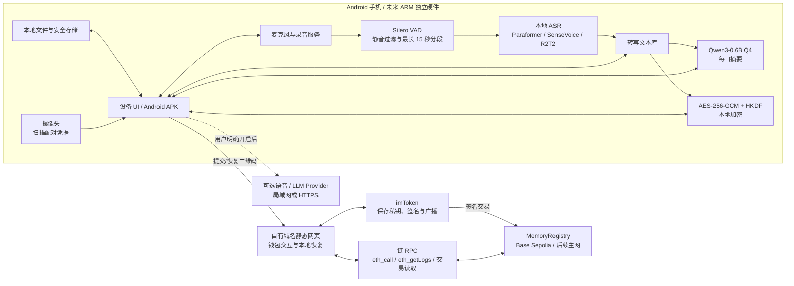
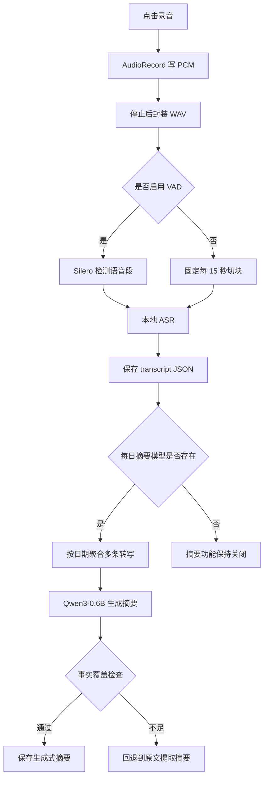
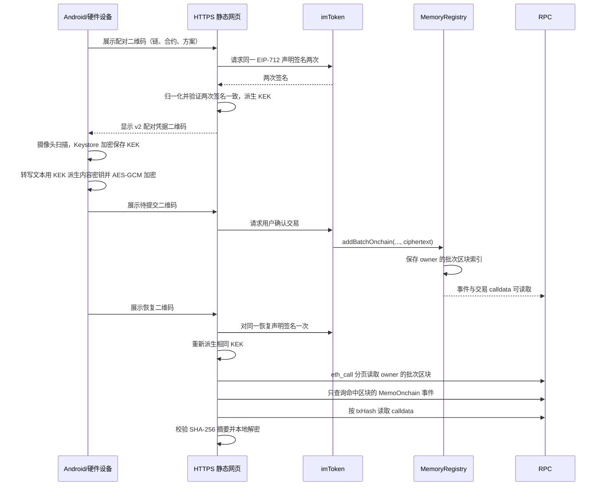
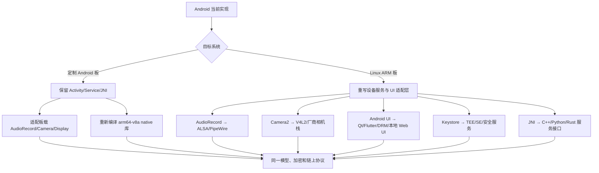

# Private Memo：

> 更新日期：2026-10-16
> 当前阶段：使用 arm64 Android 手机代替尚未到位的 ARM 开发板，验证完整软件链。
> 当前真机证据：Solana Mobile Seeker（Android 15、约 8GB RAM）；其他 Android arm64 手机可按相同步骤部署，但性能需要分别测试。

## 1. 这套原型在验证什么

Private Memo 是一套以本地录音、本地语音转写、本地加密和钱包授权恢复为核心的私密语音备忘录方案。当前 Android 手机同时代替了开发板、麦克风、屏幕、摄像头、存储和 Wi-Fi 模组，用来提前验证：

- arm64 CPU 能否加载完整模型并完成转写和摘要；
- 录音、VAD 分段、模型推理、文件管理和 UI 是否能够闭环；
- 钱包签名配对、密文上链和换机恢复是否能够闭环；
- 后续迁移到 APK 产品或与当前手机规格相近的低功耗 ARM 开发板时，哪些软件可以复用，哪些部分必须重写。

Android 手机只是**软件功能和 arm64 CPU 可运行性的替代验证设备**。它不能证明目标开发板的 NPU、内存带宽、驱动、功耗、温升、GPIO、屏幕、摄像头或电池已经满足量产要求。

后续可以形成两类产品：

1. **APK 产品**：继续以 Android 手机或定制 Android 设备为载体。
2. **独立硬件产品**：从当前手机的实测 CPU、内存和模型负载反推 arm64 Linux/Android 主板需求，再接入真实麦克风、屏幕、摄像头、按键、电池和安全元件。

## 2. 系统总架构



### 2.1 各部分的职责

| 部分 | 当前实现 | 作用与设计原因 |
| :--- | :--- | :--- |
| Android APK | Java UI、录音服务、JNI、本地文件管理 | 当前的设备软件外壳；把手机当成开发板使用，也可以直接演进成 APK 产品 |
| AudioRecord | 16kHz、单声道、16-bit PCM/WAV | 给三套 ASR 使用统一输入，便于跨模型与跨硬件比较 |
| Silero VAD | `silero_vad.onnx` | 去除纯静音，并把长音频切成最长 15 秒语音段，避免模型上下文溢出 |
| Paraformer | sherpa-onnx + ONNX Runtime | 轻量中文/中英转写基线；当前 APK 默认模型 |
| SenseVoice | sherpa-onnx + ONNX Runtime | 多语、粤语及声音事件能力的对照模型 |
| R2T2 | llama.cpp/mtmd + GGUF | 较重的高质量 ASR 对照；验证大模型式音频推理能否在端侧 CPU 运行 |
| Qwen3-0.6B Q4 | llama.cpp + GGUF | 聚合多条转写并生成每日摘要；质量门槛不满足时回退到原文提取 |
| Android Keystore | AES-GCM 包裹配对凭据 | 防止 KEK 以明文配置文件形式保存；量产独立硬件应替换为 TEE/安全元件方案 |
| 可选 Provider | 局域网 Whisper、兼容 Chat Completions 的 LLM | 用户明确开启后提供测试后备；默认关闭，不改变离线产品主线 |
| 静态网页 | `web3/app/`，部署到可信 HTTPS 域名 | 运行在 imToken DApp 浏览器中，调用钱包 Provider；无业务后端，便于审计和静态托管 |
| imToken | 钱包连接、EIP-712 签名、交易确认 | 私钥始终留在钱包；设备和静态网页都不接触钱包私钥 |
| MemoryRegistry | Solidity 合约 | 以 `msg.sender` 隔离不同钱包的记录，保存恢复索引并发出密文定位事件 |
| RPC | Alchemy 测试 RPC或 imToken Provider | 只负责读取链状态；正式产品优先使用钱包内 RPC，测试阶段可配置只读 RPC |

### 2.2 当前 APK 已完成的产品闭环

- 首页、录音、录音库、转写库、每日摘要、钱包与二维码、实验设置采用同一套 Orb 深色视觉；桌面名称按系统语言显示简体中文或英文。
- 录音支持开始、暂停、继续、停止和 5 分钟自动保存；录音库支持播放状态、重命名、单条删除和批量选择删除。
- 用户可以选择任意录音进行本地或 Provider 转写，也可以删除任意转写，或选择任意转写加密并生成提交二维码。
- 联网语音转写有独立总开关。关闭时只使用内置模型，页面和新生成文件不出现 Provider 信息；开启后才允许发送到局域网 Whisper，并将中文结果转换为简体中文。
- 钱包页支持二维码双向配对、链上提交、历史恢复，以及长按已配对钱包后清除本机凭据并重新配对。
- Qwen3-0.6B Q4 可对同一天的多条转写生成摘要；覆盖检查不通过时自动回退为按时间排列的原文提取摘要。

## 3. 关键数据流

### 3.1 录音、转写和摘要



录音和转写是两个独立对象：删除转写不会删除 WAV，重新转写也不会覆盖以前的转写 JSON。单次有效录音上限为 5 分钟，到达上限后自动保存。

### 3.2 钱包配对、上链和恢复



配对要求签名两次，是为了立即验证该钱包对同一 EIP-712 声明能否稳定产生等价签名。恢复只签一次。v2 配对凭据绑定 `chainId + contract + owner`；合约升级后必须重新配对，APK 会拒绝旧域凭据，避免生成无法恢复的新密文。

## 4. 模型作用与实测对比

当前 APK 默认模型是 **Paraformer**。三套 ASR 都保留，是为了在同一录音、同一线程数和同一设备上做可复现比较，而不是同时常驻内存。

### 4.1 模型职责

| 模型 | 文件 | 用途 | 适合场景 | 当前取舍 |
| :--- | :--- | :--- | :--- | :--- |
| Paraformer zh-small int8 | `model.int8.onnx` + `tokens.txt`，约 82MB | 普通话、中英混合、部分方言的离线转写 | 低延迟、低内存、录完后快速转写 | 当前默认工程基线 |
| SenseVoice int8 | `model.int8.onnx` + `tokens.txt`，约 237MB | 中、英、日、韩、粤语转写；能力对照 | 多语/粤语需求明确时 | 比 Paraformer 更重，保留候选 |
| Confucius4-R2T2 Q4 | 1.11GB 主模型 + 348MB 音频投影器 | 大模型式 ASR，对标更完整的文本和标点能力 | 质量对照、研究与目标板压力测试 | 内存约 3GB，暂不作为默认交互模型 |
| Qwen3-0.6B Q4 | 484MB GGUF | 多条转写的每日摘要 | 手动一键摘要、自动日摘要 | 小模型可能遗漏事实，必须配合覆盖检查和原文回退 |
| Silero VAD | 644KB ONNX | 静音检测和语音分段 | 三套 ASR 共用 | 不是转写模型 |

SenseVoice 当前使用的模型不输出标点；R2T2 当前提示固定为中文转写。模型选择必须同时比较中文 CER、英文 WER、关键实体正确率、漏句、延迟、内存、功耗和温度。

### 4.2 Seeker Android 真机结果

统一 6.74 秒音频、4 CPU 线程、每模型 3 轮：

| 模型 | 冷加载 | 推理中位数 | RTF | 最大 PSS | 失败 |
| :--- | ---: | ---: | ---: | ---: | ---: |
| Paraformer int8 | 2.17s | 94ms | 0.014 | 245,402KiB | 0/3 |
| SenseVoice int8 | 2.14s | 248ms | 0.037 | 440,776KiB | 0/3 |
| R2T2 Q4 + mmproj Q8 | 2.34s | 4.55s | 0.676 | 3,054,853KiB | 0/3 |

5 分钟合成重复语音的推理时间分别约为 Paraformer 5.39 秒、SenseVoice 10.90 秒、R2T2 213.42 秒。RTF 小于 1 只说明平均推理速度能跟上音频时长，不代表交互延迟、准确率、持续功耗或散热已达标。

原始结果见 [`results/device/REPORT.md`](results/device/REPORT.md) 和 [`results/device/benchmark-3models-3rounds.json`](results/device/benchmark-3models-3rounds.json)。

## 5. 主机下载模型

以下命令从官方或当前已验证的模型仓库下载。先进入项目根目录：

```bash
cd AI-HARDWARE
mkdir -p lab/android/models/{paraformer,sensevoice,summary}
mkdir -p lab/r2t2/models/gguf
mkdir -p /tmp/private-memo-models
```

### 5.1 Paraformer

官方说明：<https://k2-fsa.github.io/sherpa/onnx/pretrained_models/offline-paraformer/paraformer-models.html>

```bash
curl -fL --retry 3 \
  -o /tmp/private-memo-models/paraformer.tar.bz2 \
  https://github.com/k2-fsa/sherpa-onnx/releases/download/asr-models/sherpa-onnx-paraformer-zh-small-2024-03-09.tar.bz2

tar -xjf /tmp/private-memo-models/paraformer.tar.bz2 \
  -C /tmp/private-memo-models

cp /tmp/private-memo-models/sherpa-onnx-paraformer-zh-small-2024-03-09/model.int8.onnx \
  lab/android/models/paraformer/
cp /tmp/private-memo-models/sherpa-onnx-paraformer-zh-small-2024-03-09/tokens.txt \
  lab/android/models/paraformer/
```

### 5.2 SenseVoice

官方说明：<https://k2-fsa.github.io/sherpa/onnx/sense-voice/pretrained.html>

```bash
curl -fL --retry 3 \
  -o /tmp/private-memo-models/sensevoice.tar.bz2 \
  https://github.com/k2-fsa/sherpa-onnx/releases/download/asr-models/sherpa-onnx-sense-voice-zh-en-ja-ko-yue-int8-2025-09-09.tar.bz2

tar -xjf /tmp/private-memo-models/sensevoice.tar.bz2 \
  -C /tmp/private-memo-models

cp /tmp/private-memo-models/sherpa-onnx-sense-voice-zh-en-ja-ko-yue-int8-2025-09-09/model.int8.onnx \
  lab/android/models/sensevoice/
cp /tmp/private-memo-models/sherpa-onnx-sense-voice-zh-en-ja-ko-yue-int8-2025-09-09/tokens.txt \
  lab/android/models/sensevoice/
```

### 5.3 Silero VAD

```bash
curl -fL --retry 3 \
  -o lab/android/models/silero_vad.onnx \
  https://github.com/k2-fsa/sherpa-onnx/releases/download/asr-models/silero_vad.onnx
```

### 5.4 R2T2

模型仓库：<https://huggingface.co/netease-youdao/Confucius4-R2T2-GGUF>

```bash
curl -fL --retry 3 \
  -o lab/r2t2/models/gguf/Confucius4-R2T2-Q4_K_M.gguf \
  https://huggingface.co/netease-youdao/Confucius4-R2T2-GGUF/resolve/main/Confucius4-R2T2-Q4_K_M.gguf

curl -fL --retry 3 \
  -o lab/r2t2/models/gguf/mmproj-Confucius4-R2T2-Q8_0.gguf \
  https://huggingface.co/netease-youdao/Confucius4-R2T2-GGUF/resolve/main/mmproj-Confucius4-R2T2-Q8_0.gguf
```

R2T2 代码使用 Apache-2.0，模型权重使用 NetEase Model Use License。产品化前必须重新审查模型许可证及业务规模条款：<https://github.com/netease-youdao/Confucius4-R2T2/blob/master/MODEL_LICENSE>。

### 5.5 Qwen3-0.6B Q4 摘要模型

当前验证文件来自：<https://huggingface.co/QuantFactory/Qwen3-0.6B-GGUF/blob/main/Qwen3-0.6B.Q4_K_M.gguf>

```bash
curl -fL --retry 3 \
  -o lab/android/models/summary/Qwen3-0.6B-Q4_K_M.gguf \
  https://huggingface.co/QuantFactory/Qwen3-0.6B-GGUF/resolve/main/Qwen3-0.6B.Q4_K_M.gguf
```

仓库文件名包含点号 `Qwen3-0.6B.Q4_K_M.gguf`，复制到本项目时必须改为代码期望的 `Qwen3-0.6B-Q4_K_M.gguf`。

### 5.6 校验主机文件

```bash
shasum -a 256 \
  lab/android/models/paraformer/model.int8.onnx \
  lab/android/models/paraformer/tokens.txt \
  lab/android/models/sensevoice/model.int8.onnx \
  lab/android/models/sensevoice/tokens.txt \
  lab/android/models/silero_vad.onnx \
  lab/r2t2/models/gguf/Confucius4-R2T2-Q4_K_M.gguf \
  lab/r2t2/models/gguf/mmproj-Confucius4-R2T2-Q8_0.gguf \
  lab/android/models/summary/Qwen3-0.6B-Q4_K_M.gguf
```

当前已验证 SHA-256：

| 文件 | SHA-256 |
| :--- | :--- |
| Paraformer `model.int8.onnx` | `3ef6c19369b912f7caf3cef8e545c5ccd1a33d9d7ec792a46668dc41c4b229ec` |
| Paraformer `tokens.txt` | `4b2d964e18b9cf139b473003b6698fb2ed9a2a5ec55b93daa677b28f578897aa` |
| SenseVoice `model.int8.onnx` | `12ca1a2ae7ecf3e0019ef2822307ee0b5cadc9196569e379b4c4026f8205276d` |
| SenseVoice `tokens.txt` | `f449eb28dc567533d7fa59be34e2abca8784f771850c78a47fb731a31429a1dc` |
| Silero VAD | `9e2449e1087496d8d4caba907f23e0bd3f78d91fa552479bb9c23ac09cbb1fd6` |
| R2T2 Q4 | `fa3cb46c8c3a66a58812b9098ba6e96a0266d4e8c9b3cf5ba34432fd2f9f6466` |
| R2T2 mmproj Q8 | `8dc2c67e6a0484114928142d098db7ad94ae9f34c78948ef9d37a9678418cb65` |
| Qwen3-0.6B Q4 | `7af3fdf842f87b24672f8a7f1dd50404043f0bfb71093ff91c31d2b49df4631d` |

上游文件更新后哈希可能变化。出现变化时应先核对仓库版本、Git/LFS revision 和许可证，再更新项目记录，不能直接忽略。

## 6. 构建和安装 APK

当前工程不使用 Gradle，构建脚本直接调用 Android SDK、NDK、CMake、JDK、`aapt2`、`d8` 和 `apksigner`。

默认环境：

- Android SDK：`~/Desktop/android_sdk/android-sdk-macosx`
- NDK：`27.1.12297006`
- CMake：`3.22.1`
- Build Tools：`36.0.0`
- OpenJDK：17
- 目标 ABI：`arm64-v8a`
- minSdk：28
- targetSdk：35

构建：

```bash
cd AI-HARDWARE
python3 lab/android/scripts/build.py
```

产物：

```text
lab/android/build/private-memo-lab.apk
```

连接并安装：

```bash
adb devices -l

ANDROID_SERIAL=SM02G4061995016  # 替换为 adb devices 显示的序列号
adb -s "$ANDROID_SERIAL" install -r lab/android/build/private-memo-lab.apk
adb -s "$ANDROID_SERIAL" shell pm grant im.privatememo.lab android.permission.RECORD_AUDIO
adb -s "$ANDROID_SERIAL" shell pm grant im.privatememo.lab android.permission.CAMERA
adb -s "$ANDROID_SERIAL" shell pm grant im.privatememo.lab android.permission.POST_NOTIFICATIONS
```

当前实验 APK 为 `0.10.4-lab`。构建时会读取 `lab/android/.env` 的 `base-sepolia-node`，将测试用只读 RPC 写入 APK。正式分发前应移除测试 Key，并改用钱包 Provider 或正式的受控 RPC 配置。

## 7. 上传模型到 Android 手机

APK 安装后，模型放在应用专属外部目录：

```text
/sdcard/Android/data/im.privatememo.lab/files/models/
├── paraformer/model.int8.onnx
├── paraformer/tokens.txt
├── sensevoice/model.int8.onnx
├── sensevoice/tokens.txt
├── r2t2/Confucius4-R2T2-Q4_K_M.gguf
├── r2t2/mmproj-Confucius4-R2T2-Q8_0.gguf
├── summary/Qwen3-0.6B-Q4_K_M.gguf
└── silero_vad.onnx
```

创建目录并上传：

```bash
cd AI-HARDWARE
ANDROID_SERIAL=SM02G4061995016  # 替换为 adb devices 显示的序列号
DEVICE_ROOT=/sdcard/Android/data/im.privatememo.lab/files

adb -s "$ANDROID_SERIAL" shell mkdir -p \
  "$DEVICE_ROOT/models/paraformer" \
  "$DEVICE_ROOT/models/sensevoice" \
  "$DEVICE_ROOT/models/r2t2" \
  "$DEVICE_ROOT/models/summary" \
  "$DEVICE_ROOT/samples"

adb -s "$ANDROID_SERIAL" push lab/android/models/paraformer/model.int8.onnx \
  "$DEVICE_ROOT/models/paraformer/"
adb -s "$ANDROID_SERIAL" push lab/android/models/paraformer/tokens.txt \
  "$DEVICE_ROOT/models/paraformer/"

adb -s "$ANDROID_SERIAL" push lab/android/models/sensevoice/model.int8.onnx \
  "$DEVICE_ROOT/models/sensevoice/"
adb -s "$ANDROID_SERIAL" push lab/android/models/sensevoice/tokens.txt \
  "$DEVICE_ROOT/models/sensevoice/"

adb -s "$ANDROID_SERIAL" push lab/android/models/silero_vad.onnx \
  "$DEVICE_ROOT/models/"

adb -s "$ANDROID_SERIAL" push lab/r2t2/models/gguf/Confucius4-R2T2-Q4_K_M.gguf \
  "$DEVICE_ROOT/models/r2t2/"
adb -s "$ANDROID_SERIAL" push lab/r2t2/models/gguf/mmproj-Confucius4-R2T2-Q8_0.gguf \
  "$DEVICE_ROOT/models/r2t2/"

adb -s "$ANDROID_SERIAL" push lab/android/models/summary/Qwen3-0.6B-Q4_K_M.gguf \
  "$DEVICE_ROOT/models/summary/"

adb -s "$ANDROID_SERIAL" push lab/android/samples/. \
  "$DEVICE_ROOT/samples/"
```

手机端校验：

```bash
adb -s "$ANDROID_SERIAL" shell sha256sum \
  "$DEVICE_ROOT/models/paraformer/model.int8.onnx" \
  "$DEVICE_ROOT/models/paraformer/tokens.txt" \
  "$DEVICE_ROOT/models/sensevoice/model.int8.onnx" \
  "$DEVICE_ROOT/models/sensevoice/tokens.txt" \
  "$DEVICE_ROOT/models/silero_vad.onnx" \
  "$DEVICE_ROOT/models/r2t2/Confucius4-R2T2-Q4_K_M.gguf" \
  "$DEVICE_ROOT/models/r2t2/mmproj-Confucius4-R2T2-Q8_0.gguf" \
  "$DEVICE_ROOT/models/summary/Qwen3-0.6B-Q4_K_M.gguf"
```

不要只比较文件大小。主机与手机 SHA-256 必须一致，否则推理失败不能归因于模型或硬件能力。

## 8. 启动和验证

正常启动：

```bash
adb -s "$ANDROID_SERIAL" shell monkey \
  -p im.privatememo.lab \
  -c android.intent.category.LAUNCHER 1
```

在 APK 的“实验设置”中可以：

- 切换 Paraformer、SenseVoice、R2T2；
- 预加载当前模型，验证路径和运行时；
- 运行三模型、每模型三轮的固定样本比较；
- 开关 VAD；
- 配置可选的局域网 Whisper 和 LLM Provider。

命令行触发固定基准：

```bash
adb -s "$ANDROID_SERIAL" shell am start -W \
  -n im.privatememo.lab/.MainActivity \
  --es action benchmark \
  --es run_id benchmark-3models-3rounds \
  --es models paraformer,sensevoice,r2t2 \
  --es samples r2t2-official.wav \
  --ei rounds 3 \
  --ei threads 4 \
  --ez vad false
```

录音与转写：

```bash
adb -s "$ANDROID_SERIAL" shell am start -W \
  -n im.privatememo.lab/.MainActivity \
  --es action record \
  --ei seconds 5

adb -s "$ANDROID_SERIAL" shell am start -W \
  -n im.privatememo.lab/.MainActivity \
  --es action record-transcribe \
  --es model paraformer
```

结果目录：

```text
/sdcard/Android/data/im.privatememo.lab/files/
├── recordings/
├── transcripts/
├── summaries/
└── results/
```

拉回结果：

```bash
adb -s "$ANDROID_SERIAL" pull \
  /sdcard/Android/data/im.privatememo.lab/files/results \
  lab/android/results/device-latest
```

## 9. 静态网页、钱包和合约为什么这样设计

### 9.1 为什么需要静态网页

硬件设备不保存钱包私钥，也不集成 WalletConnect SDK。设备用二维码把操作载荷交给 imToken；静态网页运行在 imToken DApp 浏览器中，使用钱包注入的 EIP-1193 Provider 请求签名和交易。

选择静态网页的原因：

- 不需要业务服务器接收转写文本或配对秘密；
- 不把钱包 SDK、WalletConnect 会话维护和升级风险放进硬件固件；
- 页面源码可审计、可复现构建，可部署在自有域名；
- 二维码的敏感载荷放在 URL fragment 中，不会随普通 HTTP 请求发送给托管服务器；
- 网页关闭后不保存用户明文，恢复时重新从链上读取并在浏览器本地解密。

静态网页仍是高信任边界。正式产品需要自有域名、注册商锁和 MFA、严格 CSP、最小发布权限、可复现构建、版本展示、双托管与 DNS 切换演练。

当前页面源码：[`../../web3/app/`](../../web3/app/)
部署快照：[`../../web3/dist-page/`](../../web3/dist-page/)
测试地址：`https://ai-hardware-gamma.vercel.app/`

#### 设备丢失或损坏时的恢复入口

即使旧设备无法开机，也可以在另一台联网手机上，通过 **imToken 的 DApp 浏览器**直接打开这个[测试网恢复网页](https://ai-hardware-gamma.vercel.app/?from=0x2df3da5#r=eyJ2IjoxLCJjaGFpbklkIjo4NDUzMiwiY29udHJhY3QiOiIweDI3MzdGQWVkQmY2MjVCRjMyMDY5QTdhMDc2QTZDNDI2NDQyOTIyNzgiLCJrZXlTY2hlbWUiOiJ3YWxsZXQtc2lnbmF0dXJlLXYxIn0)。复制此链接时应包含 `#r=` 及其后的完整内容；仅打开上面的域名首页会提示“缺少载荷”。

这个链接已经预填以下公开配置，不需要从旧设备重新生成二维码，也不包含钱包私钥、配对密钥或个人录音：

| 配置 | 示例值 |
| :--- | :--- |
| 网络 | Base Sepolia 测试网，chain ID `84532` |
| 合约 | `0x2737FAedBf625BF32069A7a076A6C42644292278` |
| 部署块 | `0x2df3da5` |
| 密钥方案 | `wallet-signature-v1` |
| 记录所属地址 owner | 不预填；连接钱包后使用当前钱包地址 |
| 只读 RPC | 不预填；优先使用 imToken 注入的 Provider |

操作步骤：

1. 在 imToken 中切换到**当初配对并提交记录的同一钱包地址**，用 DApp 浏览器打开上述完整链接。
2. 点击“连接钱包”，检查页面中的链 ID 和合约与原记录一致。当前页面通过链接预填网络和合约，**没有单独选择网络、合约的菜单**。
3. 点击“钱包签名并恢复记录”，按钱包提示切换到 Base Sepolia，并对恢复声明签名一次。这是消息签名，不广播交易、不消耗 gas；不需要输入助记词或私钥。
4. 网页按钱包地址查询批次区块、事件和交易密文，校验摘要后在浏览器本地解密。恢复出的文本可以复制保存。

这条示例链接适用于上述测试网合约中的 `wallet-signature-v1` 记录。旧合约、其他网络或其他密钥方案的记录，需要使用与其原始配对一致的配置；更换新合约不能恢复旧合约中的记录。正式产品应在自有域名提供固定的恢复入口，并保留历史配置。

**恢复范围：**仅能找回已经成功上链且链上历史仍可读取的转写文本。仅生成二维码、尚未确认上链的内容，以及只保存在旧设备中的原始 WAV 和摘要，不在当前恢复范围内。

### 9.2 为什么所有用户可以使用同一个合约

合约以真实交易发送者 `msg.sender` 作为 owner。不同钱包写入同一个 MemoryRegistry，但索引分别存放在各自地址下；恢复页还会同时按合约地址和 owner topic 过滤事件。因此用户 A 不能把记录写进用户 B 的地址空间，也不能覆盖 B 的记录。

当前 Base Sepolia 索引版合约：

```text
0x2737FAedBf625BF32069A7a076A6C42644292278
部署块：0x2df3da5
```

### 9.3 为什么密文放 calldata

当前方案把加密后的短文本放进 `addBatchOnchain` 交易 calldata：

- 链上不出现明文；
- 不依赖项目自建数据库；
- `MemoOnchain` 事件保存序号、时间、摘要、偏移和长度；
- 恢复端读取交易 input，按偏移切出密文，先验证链上 SHA-256 摘要，再解密；
- 合约只额外保存每个 owner 的批次区块索引，避免恢复时从部署块扫描到最新块。

新版恢复请求量约为：

```text
1 次读取批次数
+ ceil(批次数 / 100) 次分页读取
+ 去重后的批次区块数次 eth_getLogs
+ 实际交易数次 eth_getTransactionByHash
```

请求量随用户自己的批次数增长，不再随整条链的区块高度增长。

calldata 的长期可获得性仍取决于归档节点和链政策，测试网也没有永久性承诺。正式产品需要评估主网、归档 RPC、用户导出和额外加密备份。

## 10. 演进为 APK 产品

APK 产品可以最大限度复用当前代码：

| 当前部分 | APK 产品处理方式 |
| :--- | :--- |
| Java UI 和录音服务 | 整理为正式 Android 工程，补齐生命周期、崩溃恢复和可访问性 |
| JNI + sherpa-onnx + llama.cpp | 继续使用 arm64-v8a；补充不同 SoC 和 Android 版本测试 |
| 模型文件 | 不建议全部塞进基础 APK；采用预装、首启模型包或按需下载，并做签名与哈希校验 |
| 本地文件 | 使用应用私有存储、数据库索引、导出和可控清理策略 |
| 配对凭据 | 保留 Android Keystore；评估 StrongBox、设备迁移和系统备份策略 |
| 静态网页/合约 | 可继续共用；正式切换自有域名、主网合约和生产 RPC |
| Provider | 默认关闭；开启前明确提示哪些音频或文本会离开设备 |
| 发布 | 使用正式签名、版本迁移、SBOM、第三方许可证清单和回归测试 |

APK 路线仍需验证三星 S25、Pixel、主流国产 SoC 等不同设备。Seeker 的数据不能直接代表其他手机。

## 11. 按当前 Android 实测规格选择和迁移开发板

### 11.1 当前连接设备的硬件基线

本节不是把手机型号当作目标硬件，而是把已经跑通全部模型的设备作为**资源上界参考**。2026-10-16 通过 ADB 读取到：

| 项目 | Solana Mobile Seeker 实测值 | 对选板的含义 |
| :--- | :--- | :--- |
| SoC / 板级标识 | MediaTek MT6878 | 优先比较移动/IoT SoC，不按桌面 CPU 峰值推断 |
| CPU | 8 核 arm64；4 核最高 2.0GHz，4 核最高 2.5GHz | 完整模型候选板优先采用大小核或同等级 8 核 CPU |
| 内存 | `MemTotal 7,657,856KiB`，约 7.3GiB 可用 | 完整链路以 8GB 为最低候选档；4GB 只评估轻量 ASR |
| 系统 | Android 15 / API 35，`arm64-v8a` | 定制 Android 板可最大化复用 APK；Linux 板需要重写设备适配层 |
| 数据分区 | 108GB，总空闲约 87GB | 原型板建议至少 32GB eMMC/UFS，并预留模型、录音和升级空间 |
| 显示 | 1200×2670，480dpi | 独立硬件 UI 必须按最终小屏尺寸重排，不能照搬手机像素 |
| 已测峰值 | R2T2 约 3.05GiB PSS；本地摘要约 1.35GB 总 PSS | 禁止让 R2T2、摘要模型和多个 ASR 同时常驻；8GB 仍需做压力测试 |

以后更换 Android 参考机，可用下面的命令重新生成基线：

```bash
ANDROID_SERIAL="adb-devices-显示的序列号"
adb -s "$ANDROID_SERIAL" shell getprop ro.soc.model
adb -s "$ANDROID_SERIAL" shell getprop ro.product.cpu.abi
adb -s "$ANDROID_SERIAL" shell getprop ro.build.version.release
adb -s "$ANDROID_SERIAL" shell cat /proc/meminfo
adb -s "$ANDROID_SERIAL" shell df -h /data
```

手机基线证明的是 arm64 CPU 路径可运行。手机电池、内存带宽、闪存、热设计和 Android 调度器都与裸板不同，因此不能用“核心数相同”直接替代板端测试。

### 11.2 低功耗开发板候选分档

选板条件按当前负载反推，而不是先固定某个 SoC：

- **完整链路档**：8GB RAM、arm64、板载或可接 eMMC、摄像头、音频输入和 Wi-Fi；CPU 先跑通三套 ASR 与 Qwen 摘要。
- **轻量低功耗档**：4GB～8GB RAM，只承诺 Paraformer/SenseVoice、VAD、加密、二维码和 Provider；不预设 R2T2 可达到可用时延。
- **性能余量档**：8GB 以上、8 核高性能 CPU，用来测 R2T2 和摘要连续运行；功耗与散热通常更难压到便携产品目标。

| 候选 | 官方关键规格 | 与手机基线的关系 | 建议用途 |
| :--- | :--- | :--- | :--- |
| [MediaTek Genio 700 EVK](https://genio.mediatek.com/doc/android/qsg/qsg_genio_700_intro.html) | 2×A78 2.2GHz + 6×A55 2.0GHz、6nm、8GB LPDDR4X、64GB eMMC、Wi-Fi 6、双摄、Android | 8 核异构 CPU、8GB、Android 和外设最接近当前 Seeker 验证环境 | **第一优先完整链路候选**；先验证现有 APK/JNI CPU 路径，再决定是否适配 NPU |
| [Radxa ROCK 4D](https://dl.radxa.com/rock4/4d/docs/radxa_rock4d_product_brief.pdf) | RK3576、4×A72 + 4×A53、8GB/16GB LPDDR5 可选、Wi-Fi 6、MIPI CSI/DSI、Android 14/Linux；官方建议无高负载外设时电源至少 10W | CPU 核数与内存档接近，生态和 NPU 路径不同 | **第二优先完整链路候选**；适合同时验证 Android 和 Linux 迁移，但不是唯一目标板 |
| [Radxa ZERO 3W](https://dl.radxa.com/zero3/docs/hw/3w/radxa_zero_3w_product_brief_Revision_1.8.pdf) | RK3566、4×A55 1.6GHz、1GB～8GB LPDDR4、Wi-Fi 6、MIPI CSI、5V/2A 供电、Linux | CPU 明显弱于手机；板小、供电规格低，适合探索便携功耗下限 | **轻量低功耗候选**；先测 Paraformer/SenseVoice，不把 R2T2 纳入首轮验收 |
| [Radxa ROCK 5A](https://radxa.com/products/rock5/5a/) | RK3588S、4×A76 2.2～2.4GHz + 4×A55 1.8GHz、8GB～32GB 可选、6 TOPS NPU | CPU 和内存余量高于前两档，散热与电源预算也更高 | **性能余量对照**；用于判断 R2T2 的板端上限，不直接代表低功耗量产方案 |

现阶段建议同时拿 **Genio 700 EVK 8GB** 和 **ZERO 3W 8GB** 做两端实验：前者回答“接近当前 Android 手机的板能否完整复现”，后者回答“为降低功耗和体积，删掉 R2T2 后还能保留多少功能”。ROCK 4D 8GB 可作为供应、成本和 Rockchip 生态的第三个对照。最终采购结论必须来自同一 WAV、同一模型版本和同一测量仪表下的性能与功耗数据。

表中的 5V/2A、10W 或适配器额定值是厂商供电要求，不是本项目的实测整机功耗。实际要分别测待机、录音、Paraformer 转写、R2T2 转写、摘要、屏幕点亮和 Wi-Fi 传输，并记录平均功耗、峰值功耗、温升与降频。

### 11.3 哪些可以直接复用

- 音频格式：16kHz、单声道、16-bit PCM/WAV；
- VAD 分段规则和最长 15 秒策略；
- Paraformer/SenseVoice ONNX 文件和 tokens；
- R2T2/Qwen GGUF 权重；
- AES-256-GCM、HKDF、密文格式和内容摘要；
- 配对凭据 v2、二维码载荷和钱包签名协议；
- 静态网页、合约和链上恢复格式；
- 基准音频、结果 JSON 格式和验收指标。

### 11.4 哪些必须替换或重新编译



不要把 Android 或 Mac 编译出的 `.so` 直接复制到开发板。应在目标 sysroot/板卡上重新编译：

- sherpa-onnx C API 和对应 ONNX Runtime；
- llama.cpp、mtmd 和 R2T2 音频投影代码；
- 加密依赖和设备服务；
- 相机、音频、显示、GPIO 和安全元件驱动。

开发板标注 NPU 算力不等于当前模型会自动使用 NPU。MediaTek NeuroPilot、Rockchip RKNN 等工具链各自需要模型转换、算子支持、量化误差和完整输出验证；GGUF/llama.cpp 也不能直接按 NPU 的 TOPS 数字估算。R2T2 当前没有已证明的板端 NPU 路径。第一阶段必须先建立 CPU 基线，再判断 NPU 适配投入是否必要。

### 11.5 推荐迁移顺序

1. **固定 WAV 基准**：先不接麦克风和 UI，在开发板 CPU 上跑相同模型、相同音频和相同线程数。
2. **记录资源数据**：冷启动、连续 10 次 RTF/P95、PSS/RSS、CPU 频率、温度、功耗和降频。
3. **接入录音**：用 ALSA 或 Android 音频栈验证 16kHz 单声道录音、VAD 和长录音。
4. **接入本地存储和摘要**：验证断电、磁盘不足、文件损坏和升级兼容。
5. **接入屏幕、按键和摄像头**：验证真实像素二维码、对焦距离、低亮度和长载荷扫码率。
6. **接入 Wi-Fi**：验证配网、TLS、断网恢复、Provider 超时和离线模式。
7. **接入 TEE/安全元件**：实现 KEK 导入、不可导出保存和设备身份绑定。
8. **跑钱包完整闭环**：配对、提交、恢复、更换钱包、合约升级和旧数据读取。
9. **再做电池和外壳**：测量最终麦克风、天线、屏幕和散热结构下的真实续航与皮肤温度。

### 11.6 板端 Linux 参考启动结构

Linux 版本可以保留现有 `lab/server.py` 作为早期服务外壳：

```text
AI-HARDWARE/
├── lab/server.py
├── lab/mic_rt.py
├── lab/crypto/
├── lab/ui/
├── lab/r2t2/
├── web3/app/
└── web3/src/MemoryRegistry.sol
```

依赖基线：

```text
Python 3
NumPy
sherpa-onnx / ONNX Runtime
llama.cpp + mtmd
cryptography
segno 或其他 QR 编码器
ALSA / arecord
V4L2 或厂商相机栈
```

录音设备验证：

```bash
arecord -l
arecord -D hw:DEVICE,CARD -f S16_LE -r 16000 -c 1 test.wav
```

R2T2 必须在目标板重新编译，并为动态库设置目标板路径：

```bash
export LD_LIBRARY_PATH=/path/to/r2t2/build/linux-arm64/bin
```

早期服务启动示例：

```bash
cd AI-HARDWARE/lab
python3 server.py \
  --host 0.0.0.0 \
  --port 8099 \
  --device hw:DEVICE,CARD \
  --contract 0x2737FAedBf625BF32069A7a076A6C42644292278 \
  --chain-id 84532 \
  --deploy-block 0x2df3da5 \
  --page-url https://memo.example.com/ \
  --rpc-url https://base-sepolia.example-rpc.invalid
```

板端 HTTP 页面用于局域网调试；imToken 打开的仍应是公网可信 HTTPS 静态页面。

## 12. 产品化验收清单

### 模型与性能

- 使用独立人工标注集统计中文 CER、英文 WER、关键实体和漏句率；
- 覆盖普通话、方言、中英混说、噪声、远场、金额、日期和专有名词；
- 记录 30 秒、2 分钟、5 分钟录音的 P50/P95、峰值内存和失败率；
- 在最终散热结构中测量持续推理温度、降频、平均/峰值功耗和单位音频能耗；
- 分别测试 ASR、摘要以及两者连续运行后的内存回收。

### 数据与安全

- 明确录音、明文转写、摘要和密文的保留及删除策略；
- Provider 默认关闭，开启前显示数据离开设备的范围；
- KEK 不写日志、不进入 URL、不上传分析系统；
- 配对二维码加入设备身份、nonce、过期时间、防重放和双方确认；
- 静态页面使用自有域名、MFA、CSP、最小发布权限和可验证版本；
- 合约升级必须同步处理配对域、旧合约读取和数据迁移策略；
- 主网前重新评估 gas、RPC、归档节点、备份和恢复可用性。

### 硬件

- 麦克风阵列、Codec/PDM/I2S、安装声学和隐私物理开关；
- 屏幕分辨率、亮度、真实二维码扫码成功率；
- 摄像头近距离对焦、低照度、反光和长载荷识别；
- Wi-Fi 天线净空、断网恢复和证书校验；
- TEE/安全元件、固件签名、安全启动和升级回滚；
- 电池、充电、电源路径、低电量保存、休眠唤醒和整机热设计。

## 13. 相关文件

| 内容 | 路径 |
| :--- | :--- |
| Android 构建脚本 | [`scripts/build.py`](scripts/build.py) |
| Android JNI 推理桥 | [`cpp/memo_native.cpp`](cpp/memo_native.cpp) |
| 真机结果 | [`results/device/`](results/device/) |
| 总体项目说明 | [`../../README.md`](../../README.md) |
| 架构设计 | [`../../docs/architecture/架构设计.md`](../../docs/architecture/架构设计.md) |
| 调研与模型证据 | [`../../docs/research/调研报告.md`](../../docs/research/调研报告.md) |
| 静态网页源码 | [`../../web3/app/`](../../web3/app/) |
| 网页部署快照 | [`../../web3/dist-page/`](../../web3/dist-page/) |
| 合约源码 | [`../../web3/src/MemoryRegistry.sol`](../../web3/src/MemoryRegistry.sol) |
